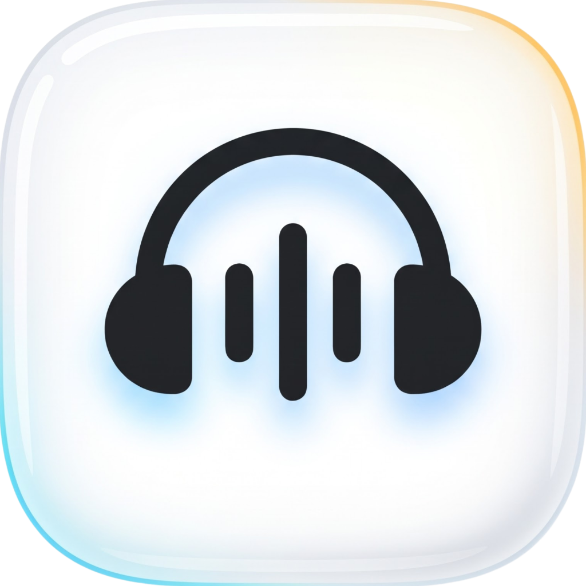

  
  <h1>Muzix</h1>
  
Cliente de YouTube Music para Android, baseado no SimpMusic.

  

    <a href="https://github.com/jpcmpc123/Muzix/releases">Download (GitHub Releases)</a>
  

---

## Recursos

- Reprodução de músicas do YouTube Music e do YouTube gratuitamente, sem anúncios e em segundo plano
- Reconhecimento de música tocando ao seu redor, com busca direta no Muzix (Android)
- Criação e edição de letras sincronizadas (linha por linha ou palavra por palavra)
- Leitura e interação com comentários do YouTube direto na tela Em Reprodução
- Três estilos para a tela Em Reprodução: Clássico, Material 3 Expressive e estilo Apple Music com letras sincronizadas
- Equalizador de 10 bandas com presets e perfis AutoEq, além de Delay, Reverb e equalizador do sistema Android
- Escolha do dispositivo de saída (alto-falante, fone ou Cast) sem alterar o áudio de outros aplicativos
- Muzix Wrapped: retrospectiva anual e playlists mensais de resumo
- Estatísticas locais de escuta: gráficos, histórico por período, relógio de escuta e recibo compartilhável
- Letras sincronizadas (incluindo palavra por palavra), romanização, compartilhamento como imagem, modo paisagem em tela cheia e ajuste de sincronia
- Widgets na tela inicial (vitrola, playlists e estatísticas)
- Idioma de áudio preferido para vídeos com múltiplas faixas de áudio
- Streaming de alta qualidade (Opus/AAC) e opção de reprodução de vídeo 1080p com legendas
- Navegação rápida por Início, Paradas, Podcasts, Humores e Gêneros do YouTube Music
- Busca completa no YouTube e YouTube Music
- Suporte a Spotify Canvas e capas animadas
- Rádios ao vivo do YouTube Music, sugestões de músicas e análise de gosto musical
- Importação de playlists convertidas do Spotify e de outros aplicativos
- Playlists personalizadas sincronizadas com o YouTube Music
- Notificações de artistas seguidos
- Cache, reprodução offline e downloads inteligentes
- Crossfade e personalização de tema (claro, escuro e cores)
- Letras sincronizadas via SimpMusic Lyrics, LRCLIB, BetterLyrics, Spotify (requer login) e YouTube Transcript, com tradução por IA (opcional)
- Suporte a múltiplas contas do YouTube, Last.fm scrobbling, SponsorBlock, Return YouTube Dislike, temporizador (Sleep Timer), Android Auto, Discord Rich Presence e Listen Together

> **Aviso:** Por depender do YouTube Music, erros ocasionais de reprodução podem ocorrer devido a mudanças externas do serviço.

## Instalação

Distribuição exclusivamente via [GitHub Releases](https://github.com/jpcmpc123/Muzix/releases).

- O Muzix usa o identificador `com.jpcmpc123.muzix` e instala como um aplicativo separado (lado a lado com o SimpMusic oficial).

## Privacidade

O Muzix não possui rastreadores nem servidores próprios para coleta de dados do usuário. Caso você faça login e ative a opção de enviar histórico ao Google, o aplicativo comunica-se apenas com a API do YouTube Music para melhorar recomendações e sincronizar sua biblioteca.

## Aviso Legal

O Muzix é um software livre (GPLv3) criado para uso pessoal e educacional, sem fins comerciais e sem anúncios. O aplicativo não hospeda, distribui nem armazena arquivos de mídia protegidos por direitos autorais — todo o conteúdo reproduzido é acessado diretamente a partir das plataformas públicas do YouTube / YouTube Music.

## Créditos

**Baseado no SimpMusic, de maxrave-dev, licenciado sob a GPLv3.**

- Repositório original: [maxrave-dev/SimpMusic](https://github.com/maxrave-dev/SimpMusic)
- Licença: [GPLv3](LICENSE)
- Mantenedor desta versão: [jpcmpc123](https://github.com/jpcmpc123)

Projetos e serviços de terceiros utilizados/inspiradores:
- [InnerTune](https://github.com/z-huang/InnerTune/)
- [SmartTube](https://github.com/yuliskov/SmartTube)
- [SponsorBlock](https://sponsor.ajay.app/)
- [LRCLIB](https://lrclib.net/)
- [Metrolist](https://github.com/MetrolistGroup/Metrolist)
